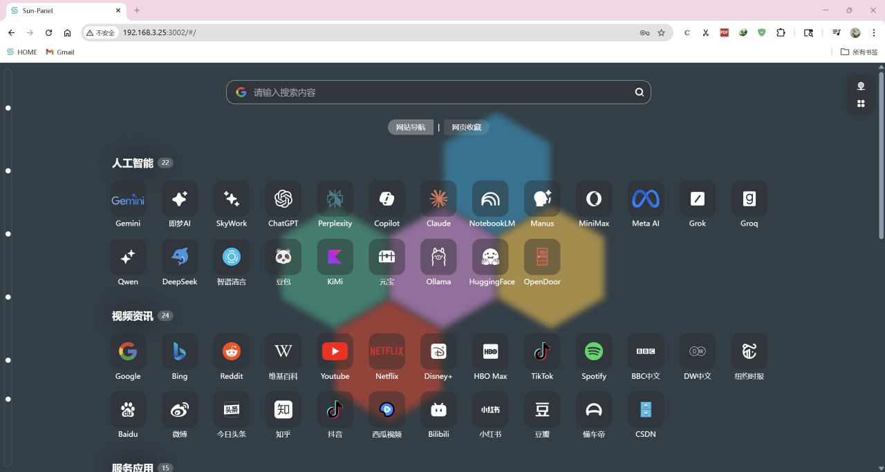
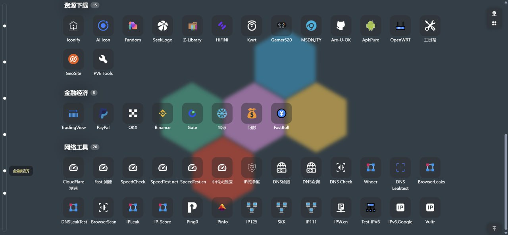
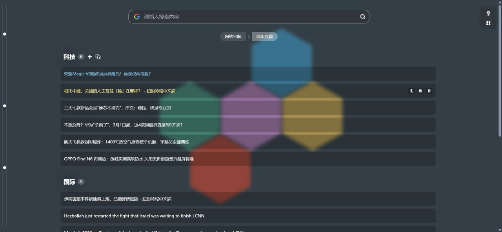
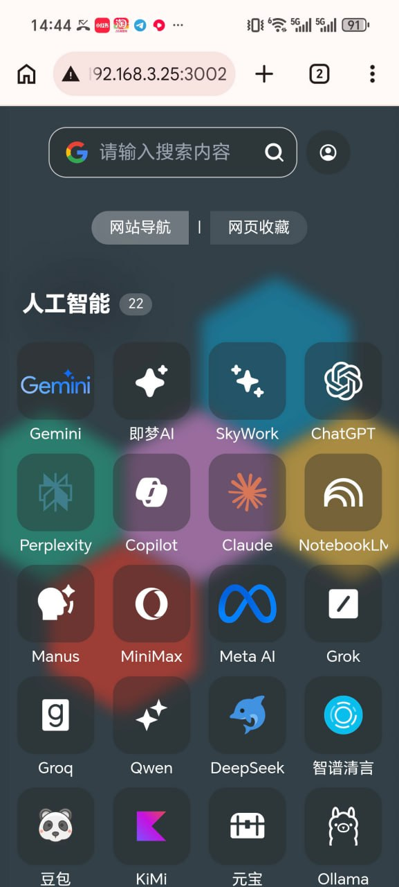
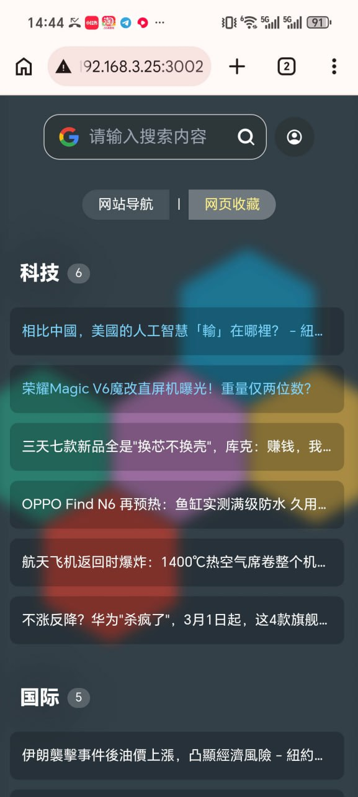

[[ 简体中文 ]](https://github.com/laozixh/XH-Panel/blob/main/README.md) |
[[ English ]](https://github.com/laozixh/XH-Panel/blob/main/README_EN.md)

<div align=center>



# XH-Panel

[](https://github.com/laozixh/XH-Panel)
[](https://github.com/laozixh/XH-Panel/pkgs/container/xh-panel) 
<br>

</div>

A perfect website navigation + webpage bookmarks panel.

---

## Main Features

### 1) Left Sidebar Navigation (Quick Jump)


- New "group sidebar" on the left side of the page. Click dots to **jump instantly** to the corresponding group.
- No more scrolling when you have many groups.

### 2) Two Collection Modes: Website + Webpage
- **Website**: Perfect for收藏「a site」and its entry points (e.g., NAS, blog, admin panel).
- **Webpage**: Perfect for收藏「an article / a page」link (e.g., Zhihu articles, news links, tutorial pages).
- Switch between "Website / Webpage" freely - search conditions are preserved.

### 3) Webpage Collection Enhanced


- Webpage list supports: one-click pin/unpin, quick edit, quick delete.
- Pin/Create/Edit/Delete **won't refresh the entire page** - no flashing or jumping.

### 4) Icons & Wallpapers - Separate Management with Reuse
- Distinguish between "icons" and "wallpapers" when uploading images.
- Previously uploaded icons/wallpapers can be **reused** from history - no need to re-upload every time.

### 5) Thoughtful UX Improvements
- Duplicate link detection (avoid saving the same URL twice).
- Auto-ellipsis for list titles, hover to see full names.
- Mobile-optimized experience (more compact, cleaner).




## 🐳 Docker Deployment (Recommended)

```bash
docker run -d --name xh-panel --restart=unless-stopped \
  -p 3005:3005 \
  -v /root/xh-data:/data \
  ghcr.io/laozixh/xh-panel:latest
```

> Note: Only use the `latest` Docker image. `/root/xh-data` persists `conf`, `database`, `uploads`, and `runtime`. Keep this directory when upgrading.

Upgrade:

```bash
docker pull ghcr.io/laozixh/xh-panel:latest
docker stop xh-panel && docker rm xh-panel
docker run -d --name xh-panel --restart=unless-stopped \
  -p 3005:3005 \
  -v /root/xh-data:/data \
  ghcr.io/laozixh/xh-panel:latest
```

## 🔐 First Login

URL: http://[IP]:3005
- **Default Admin Username**: `admin`
- **Default Admin Password**: `admin`

On first startup, sample groups and example website/webpage links will be created automatically for quick testing.

> ⚠️ Please change your password after first login!

## 📋 Documentation

- [中文文档](https://github.com/laozixh/XH-Panel/blob/main/README.md)
- [English Documentation](https://github.com/laozixh/XH-Panel/blob/main/README_EN.md)

---

## ❤️ Thanks

- [Sun-Panel v1.3.0](https://github.com/hslr-s/sun-panel) - Original project

---

[](https://star-history.com/#laozixh/XH-Panel&Date)
